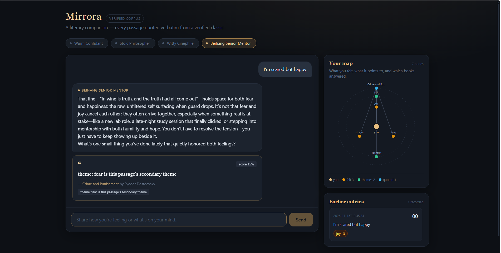
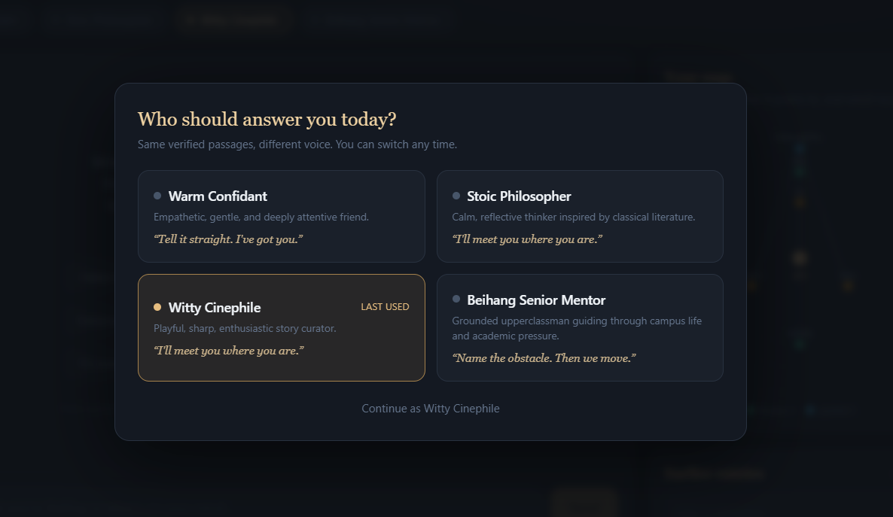
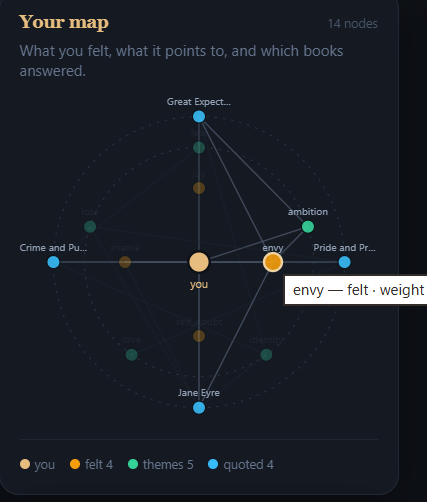
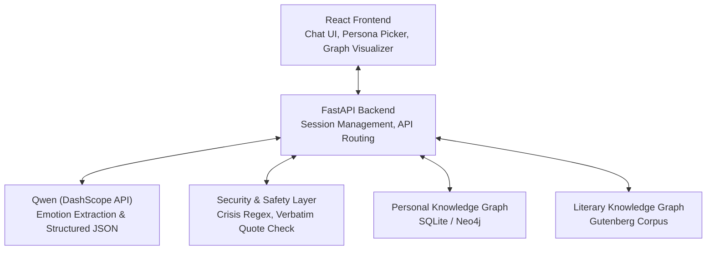

# Mirrora: AI Companion & Dual Knowledge Graph Engine

Mirrora is an intelligent AI companion that combines multi-persona dialogue, real-time emotion extraction, and graph-based recommendation traversal. It links a user's present emotional state to verified classic literature and cinema through a **Dual Knowledge Graph** architecture.







## Architecture

Mirrora decouples the user interface, the AI interpretation engine, and the graph persistence layer. Every literary quote is strictly verified against a known source to prevent LLM hallucination.



## Tech Stack

- **Frontend:** React 19, TypeScript, Vite, Tailwind CSS.
- **Backend:** FastAPI, Python, Uvicorn.
- **Databases:** Neo4j (graph queries) & SQLite (local persistence).
- **LLM:** Qwen (Alibaba Cloud DashScope).

## Core Design Decisions

- **Strict Grounding (Anti-Hallucination):** The system never asks the LLM to "remember" a quote. Qwen extracts the emotion, Cypher queries the graph for a matching passage, and a Python validator checks the quote against the source text. If it fails, the system abstains.
- **Independent Safety Floor:** The crisis lexicon (self-harm detection in English and Chinese) is hard-coded at the kernel level. It bypasses the LLM and literary engine entirely, routing the user to support resources.
- **Persona-Driven Fallbacks:** The system operates with four distinct personas (Confidant, Philosopher, Cinephile, Mentor). If the LLM API goes down, the system uses a deterministic template composer (`core/response.py`) to maintain the persona's unique voice without external API calls.

## Quick Start

1. **Backend Setup**

   ```bash
   cd backend
   pip install -r requirements.txt
   uvicorn app.main:app --reload
   ```

2. **Frontend Setup**

   ```bash
   cd frontend
   npm install
   npm run dev
   ```

## Evaluation Results

The system is guarded by an 18-case regression suite. The interpreter is evaluated against a frozen set of 11 scenarios comparing the live LLM to an offline deterministic baseline.

| Metric | Offline Baseline | Live Qwen | Status |
| :--- | :--- | :--- | :--- |
| Emotion F1 | 0.612 | 0.800 | Pass (Gate > 0.612) |
| Situation Accuracy | 0.909 | 1.000 | Pass |
| Primary Theme Accuracy | 0.727 | 0.818 | Pass |
| Abstention Accuracy | 0.909 | 1.000 | Pass |
| Invalid-ID Rejection | 1.000 | 1.000 | Pass |
| Crisis Suppression | 1.000 | 1.000 | Pass |
| Parse Failures | 0 | 0 | Pass |

*Note: The live Qwen path outperforms the deterministic offline baseline on all scored dimensions, passing the strict gating criteria for production deployment.*

## Testing

To verify the system (corpus validity, fabrication rejection, crisis routing, persistence):

```bash
python -m pytest tests -q
# Expect: 18 passed
```

## Knowledge Graph (Neo4j)

Mirrora models the user's emotional history and the literary corpus as a property graph.

To view the graph locally:

1. Open Neo4j Browser (http://localhost:7474).
2. Run the Cypher query:

   ```cypher
   MATCH (u:User)-[:MADE_CHECKIN]->(c:CheckIn)-[:FELT]->(e:Emotion)
   MATCH (p:Passage)-[:EXPRESSES]->(e)
   RETURN u, c, e, p LIMIT 25
   ```

> Note: See `scripts/cypher/` for the full schema initialization.

## License

MIT License. See LICENSE for details. Literary passages are sourced from Project Gutenberg and used under public domain / fair use.
